# TravelMemory - Deployment on AWS EC2

**App URL:** https://travel.rajeshdevops.in (goes through the load balancer)
**Frontend server direct:** https://fe.rajeshdevops.in (A record to frontend-1)

> Note: all AWS resources were deleted after testing to avoid charges, so these links are not live anymore. The screenshots below were taken while everything was running.

TravelMemory is a MERN app (forked from [UnpredictablePrashant/TravelMemory](https://github.com/UnpredictablePrashant/TravelMemory)). In this project I deployed it on AWS EC2. The setup has 2 frontend and 2 backend servers behind an Application Load Balancer, nginx on every server, MongoDB Atlas as the database and my own domain connected through Cloudflare.

---

## Architecture

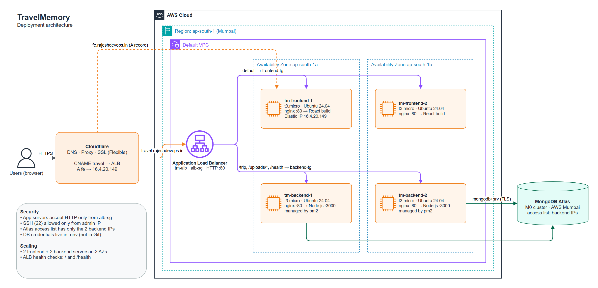

The draw.io file is in [docs/architecture.drawio](docs/architecture.drawio) (open it on app.diagrams.net to edit).

How a request moves:

1. User opens `travel.rajeshdevops.in`. Cloudflare answers the DNS query and handles HTTPS.
2. Cloudflare forwards the request to the AWS Application Load Balancer (CNAME record).
3. The load balancer looks at the path:
   - `/trip`, `/trip/*`, `/uploads/*`, `/health` go to the **backend** target group
   - everything else goes to the **frontend** target group
4. Frontend servers serve the React build with nginx. Backend servers have nginx in front of Node.js running on port 3000.
5. The backend reads and writes data in MongoDB Atlas.

`fe.rajeshdevops.in` is an A record that points to the Elastic IP of frontend-1, so that server can also be opened directly.

---

## Tools and services

| What | Used for |
|---|---|
| AWS EC2 (4 x t3.micro, Ubuntu 24.04) | 2 frontend + 2 backend servers |
| Application Load Balancer | Splitting traffic between servers, path based routing, health checks |
| Elastic IP | Fixed public IP for frontend-1 (needed for the A record) |
| Security Groups | Firewall rules |
| nginx | Reverse proxy for backend, static file server for frontend |
| Node.js 20 + pm2 | Running the backend and keeping it alive |
| MongoDB Atlas (M0 free, AWS Mumbai) | Database |
| Cloudflare (free plan) | DNS, proxy and HTTPS |
| GoDaddy | Domain `rajeshdevops.in` |
| AWS CLI | Creating the AWS resources |

## Files I added to the repo

```
deploy/
  nginx-backend.conf     nginx reverse proxy config for the backend servers
  nginx-frontend.conf    nginx config for the frontend servers
docs/
  architecture.png / architecture.drawio
  screenshots/
```

---

## Step 1 - Database (MongoDB Atlas)

1. Created a free **M0** cluster on Atlas in the **AWS Mumbai (ap-south-1)** region, same region as the servers.
2. Created a database user.
3. In **Network Access** I allowed only the public IPs of the two backend servers.
4. Took the connection string from **Connect > Drivers** and added `/travelmemory` as the database name.

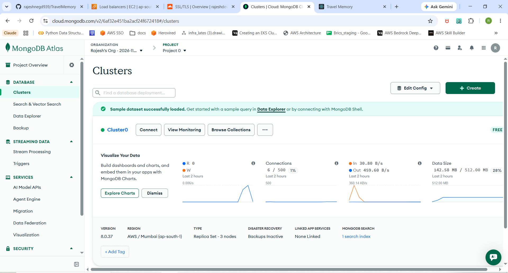
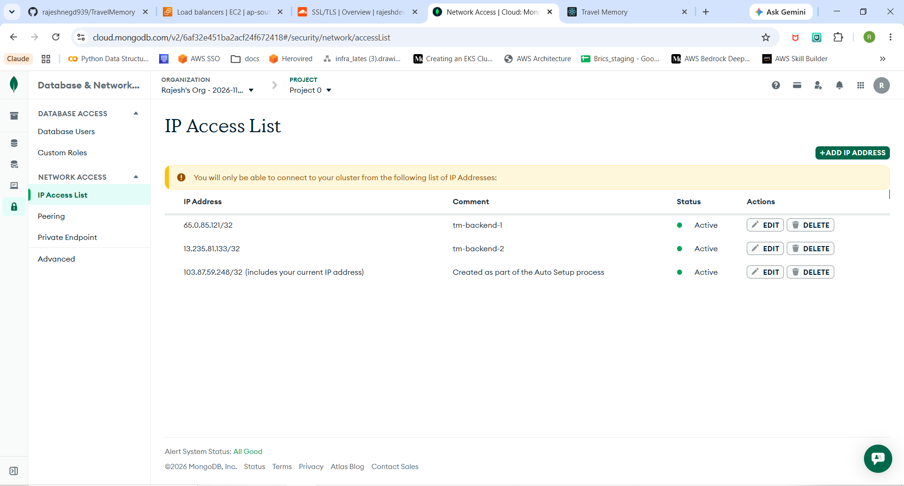

## Step 2 - Backend configuration

### .env

The backend code uses port 3001 by default. The assignment asks for 3000, so I set `PORT=3000` in `backend/.env`.

This is the `.env` on the backend servers (DB password hidden):

```
MONGO_URI=<hidden>
PORT=3000
CORS_ORIGIN=https://travel.rajeshdevops.in,https://fe.rajeshdevops.in,http://fe.rajeshdevops.in
# Cloudflare -> ALB -> nginx
TRUST_PROXY=3
NODE_ENV=production
```

- `CORS_ORIGIN` lists the domains that are allowed to call the API from the browser.
- `TRUST_PROXY=3` because every request passes through 3 proxies (Cloudflare, ALB, nginx). Without this the rate limiter sees the proxy IP instead of the real user IP.
- `.env` is in `.gitignore`, so the DB password never goes to GitHub. The file is created on the server at first boot by the EC2 user data.

### nginx reverse proxy

Node listens on `127.0.0.1:3000` and nginx listens on port 80 and passes requests to it. File: [deploy/nginx-backend.conf](deploy/nginx-backend.conf)

```nginx
server {
    listen 80 default_server;
    server_name _;
    client_max_body_size 6M;   # image uploads are max 5 MB

    location / {
        proxy_pass http://127.0.0.1:3000;
        proxy_http_version 1.1;
        proxy_set_header Host $host;
        proxy_set_header X-Real-IP $remote_addr;
        proxy_set_header X-Forwarded-For $proxy_add_x_forwarded_for;
        proxy_set_header X-Forwarded-Proto $scheme;
    }
}
```

### pm2

The backend runs with **pm2** instead of plain `node index.js`. pm2 keeps the app running in the background, restarts it if it crashes, and starts it again after a server reboot (`pm2 startup` + `pm2 save`).

Output from backend-1:

```
$ node -v
v20.20.2

$ sudo pm2 status
│ id │ name        │ mode │ status │ mem    │
│ 0  │ tm-backend  │ fork │ online │ 71.6mb │

$ sudo nginx -t
nginx: configuration file /etc/nginx/nginx.conf test is successful

$ curl localhost:3000/health          # node directly
{"status":"ok","db":"connected"}

$ curl localhost/health               # through nginx
{"status":"ok","db":"connected"}
```

## Step 3 - Connecting frontend and backend

The frontend URL file is `frontend/src/url.js` (the assignment calls it `urls.js`):

```js
export const baseUrl = process.env.REACT_APP_BACKEND_URL || "http://localhost:3001";
```

It already reads the backend URL from an environment variable, so I did not hardcode anything. Before building I created `frontend/.env`:

```
REACT_APP_BACKEND_URL=https://travel.rajeshdevops.in
```

React puts this value into the build at build time. Since the load balancer sends `/trip` and `/health` to the backend, the frontend and the API are on the same domain.

On the frontend servers:

```bash
npm ci
npm run build
sudo cp -r build/* /var/www/travelmemory/
```

nginx serves the build. `try_files` sends every unknown path to `index.html` so React Router pages (like `/experiencedetails/:id`) work after a refresh. File: [deploy/nginx-frontend.conf](deploy/nginx-frontend.conf)

```nginx
server {
    listen 80 default_server;
    root /var/www/travelmemory;
    index index.html;

    location / {
        try_files $uri /index.html;
    }
}
```

t3.micro has only 1 GB RAM and the React build needs more, so 2 GB swap is added on the frontend servers before building.

## Step 4 - AWS infrastructure (EC2, security groups, EIP)

I created the AWS resources with the AWS CLI. Region is `ap-south-1` (Mumbai) and everything is in the default VPC. Order:

1. Key pair `travel-key`
2. 3 security groups
3. 4 EC2 instances (Ubuntu 24.04, t3.micro), spread over 2 availability zones
4. Elastic IP for frontend-1
5. 2 target groups, with the instances registered
6. Application Load Balancer, listener and path rule

Each instance got **user data** that runs on first boot. It clones this repo, installs Node.js 20, nginx (and pm2 on the backend), writes the `.env`, copies the nginx config from `deploy/` and starts the app. The frontend servers also build React and copy the build to `/var/www/travelmemory`. So no manual SSH work was needed on the servers.

| Server | AZ | Role |
|---|---|---|
| tm-frontend-1 | ap-south-1a | nginx + React build, Elastic IP 16.4.20.149 |
| tm-frontend-2 | ap-south-1b | nginx + React build |
| tm-backend-1 | ap-south-1a | nginx + Node.js (pm2) |
| tm-backend-2 | ap-south-1b | nginx + Node.js (pm2) |

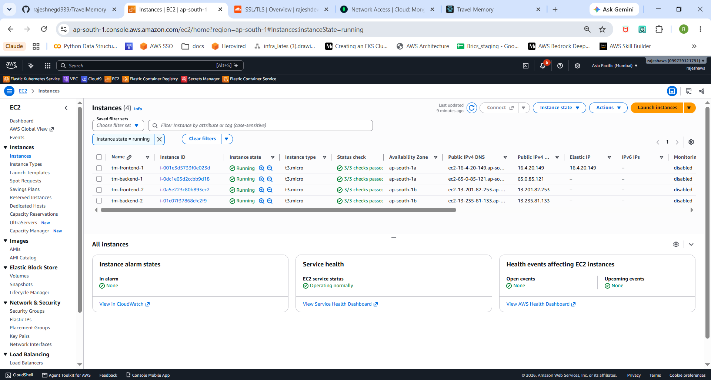

### Security groups

| Group | Inbound rules | Attached to |
|---|---|---|
| `alb-sg` | 80, 443 from anywhere | Load balancer |
| `app-sg` | 80 only from `alb-sg`, 22 only from my IP | All 4 servers |
| `fe-public-sg` | 80 from anywhere | Only frontend-1 (for the A record) |

So the backend servers can't be reached directly from the internet, only through the load balancer.

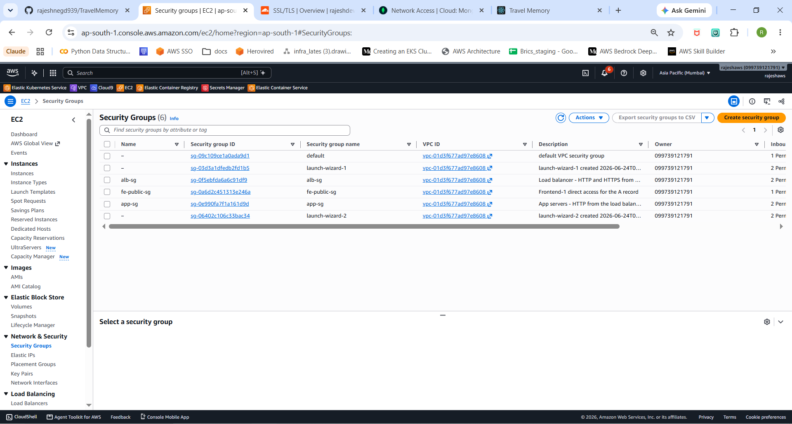

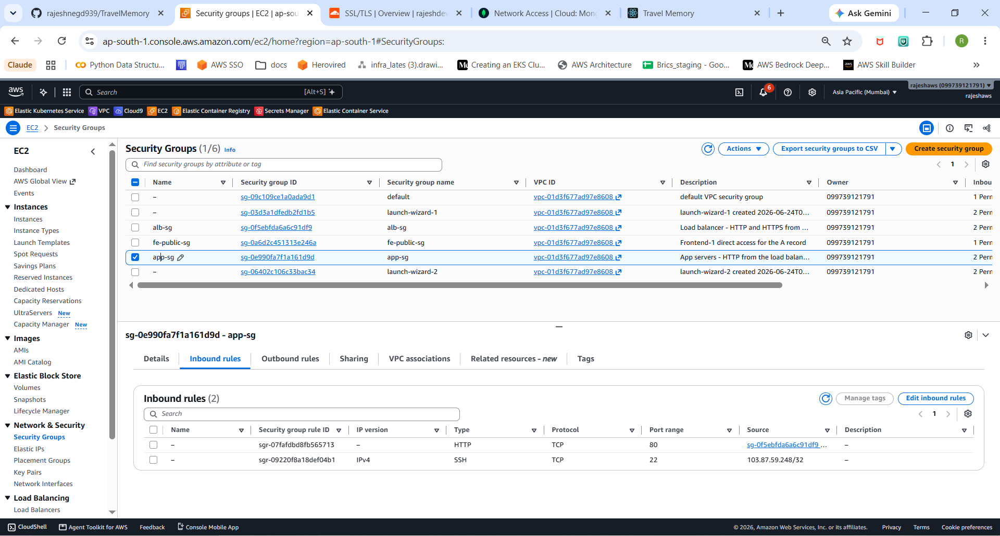
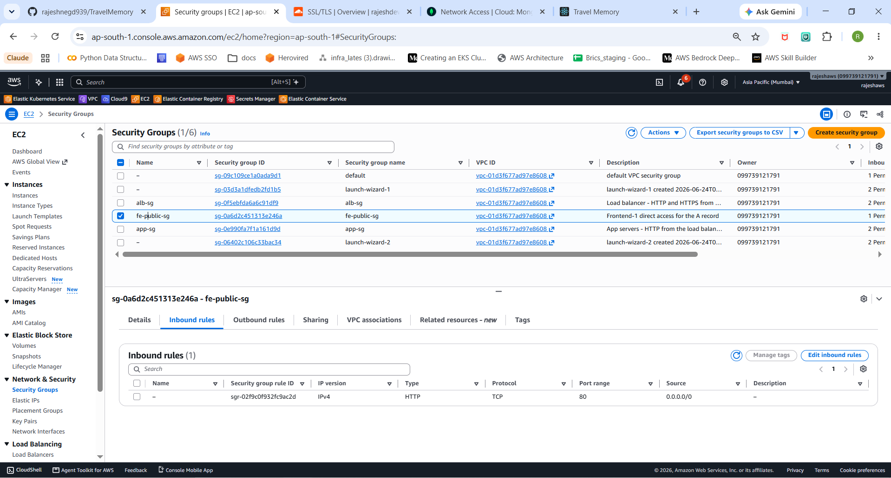

## Step 5 - Load balancer

- Name `tm-alb`, internet-facing, in 2 availability zones
- Listener **HTTP : 80**

| Priority | Condition | Forward to |
|---|---|---|
| 10 | path is `/trip`, `/trip/*`, `/uploads/*` or `/health` | `tm-backend-tg` |
| default | anything else | `tm-frontend-tg` |

Health checks: backend target group checks `/health` (returns 200 only when the DB is connected), frontend target group checks `/`.

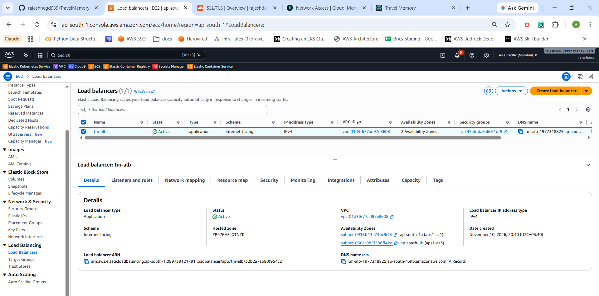
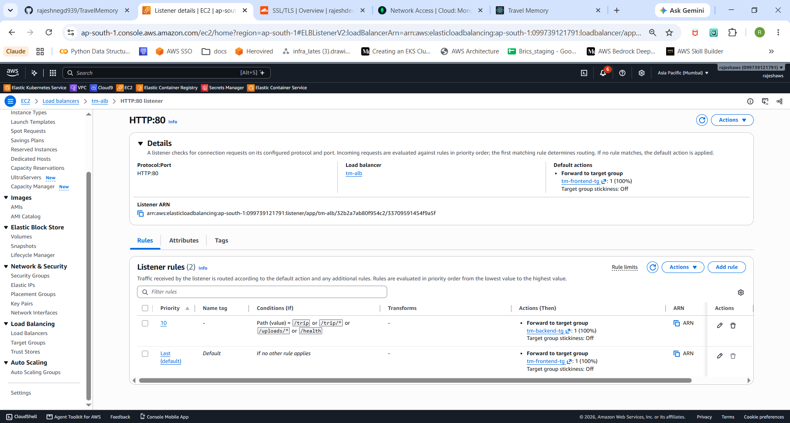
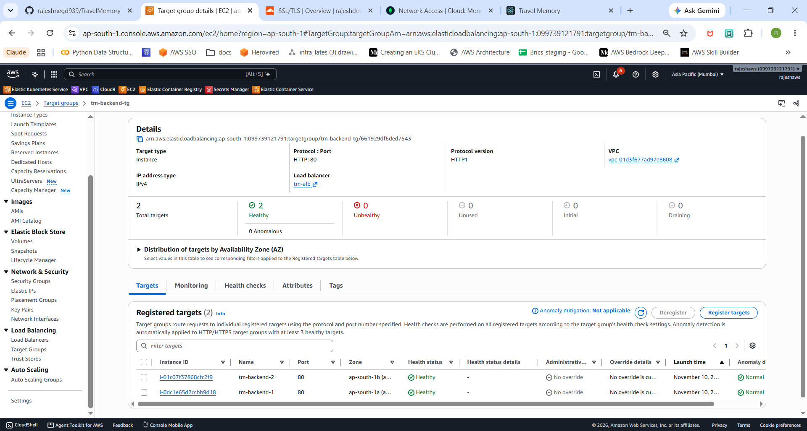
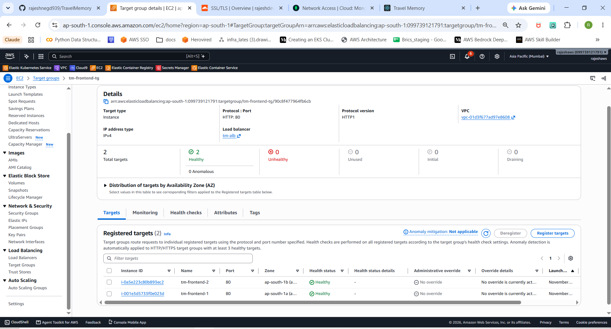

## Step 6 - Domain with Cloudflare

1. Cloudflare Registrar does not sell `.in` domains, so I bought `rajeshdevops.in` on **GoDaddy**.
2. Added the domain to Cloudflare (free plan) with **Add a domain**.
3. In GoDaddy I changed the nameservers to the Cloudflare ones (`dale.ns.cloudflare.com`, `ziggy.ns.cloudflare.com`).
4. Added the DNS records:

| Type | Name | Points to | Proxy |
|---|---|---|---|
| CNAME | `travel` | `tm-alb-1977318825.ap-south-1.elb.amazonaws.com` | Proxied |
| A | `fe` | `16.4.20.149` (Elastic IP of frontend-1) | Proxied |

5. SSL/TLS mode set to **Flexible**. Browser to Cloudflare is HTTPS, Cloudflare to AWS is HTTP on port 80.

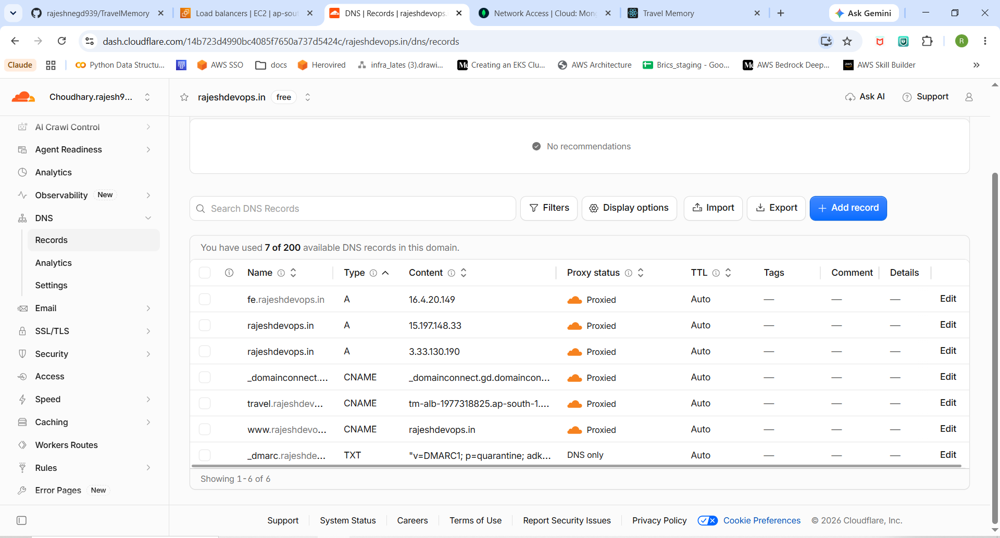
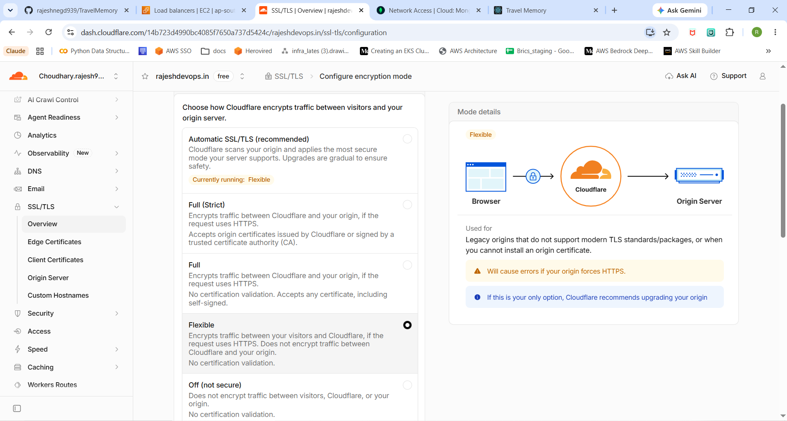

## Step 7 - Testing

API health through the domain:


App running on the domain:

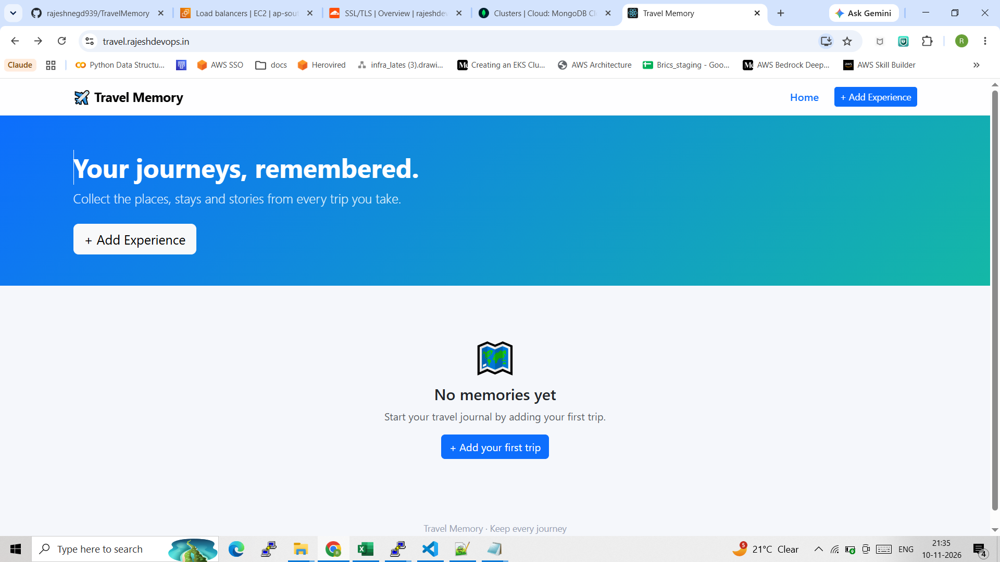
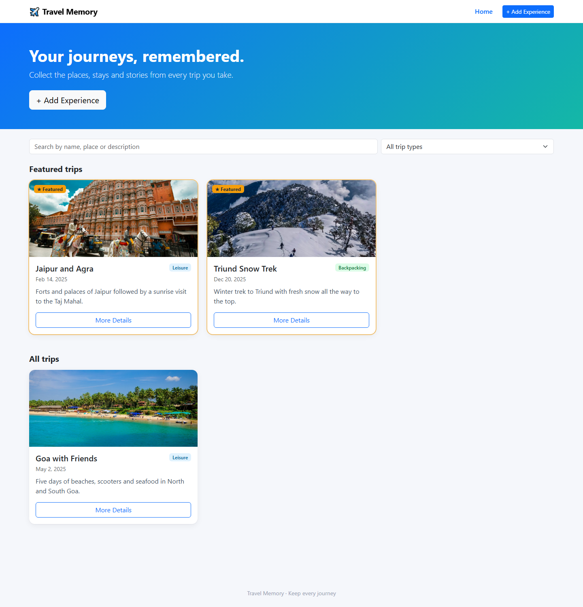
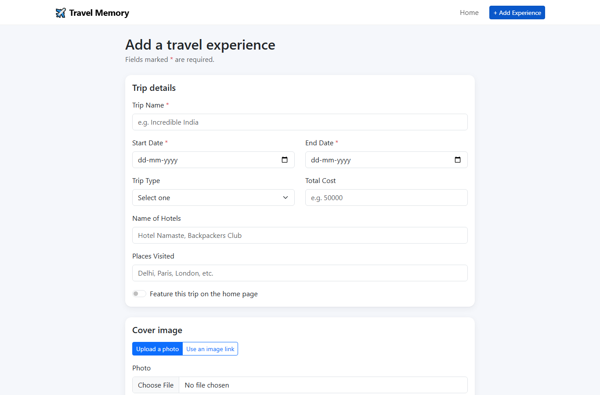
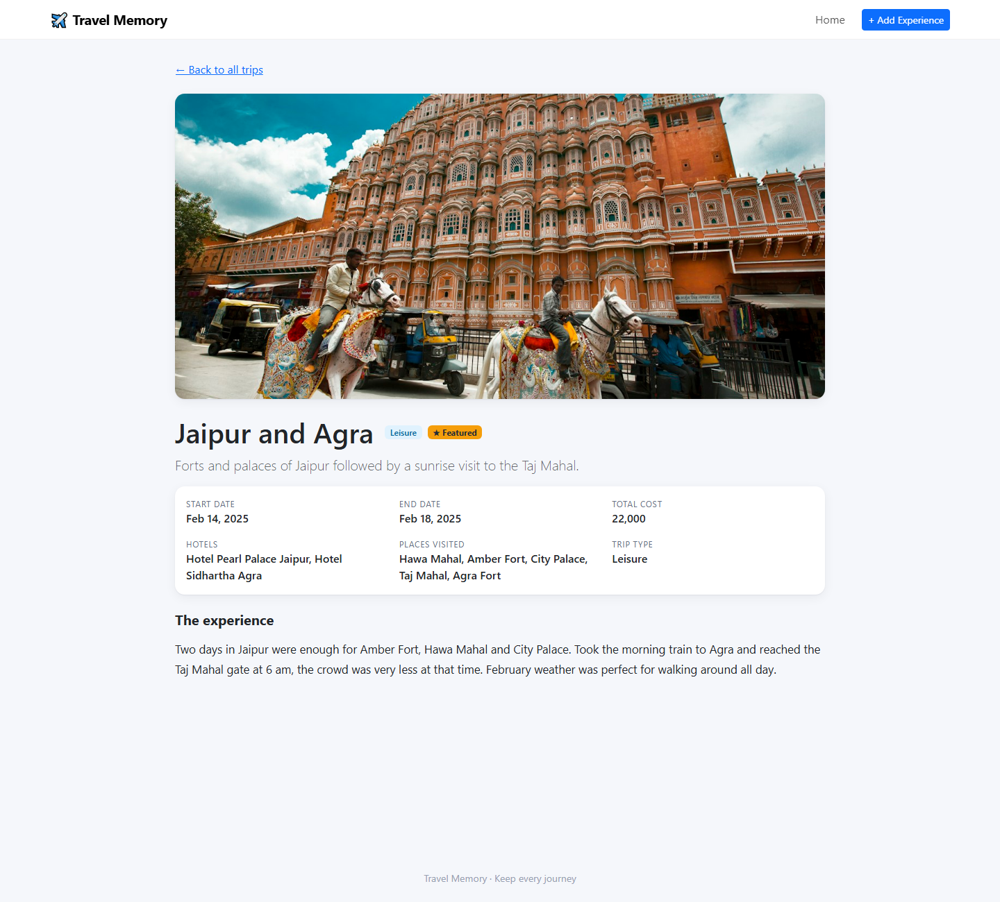

Same app on `fe.rajeshdevops.in` (A record, frontend-1 directly):

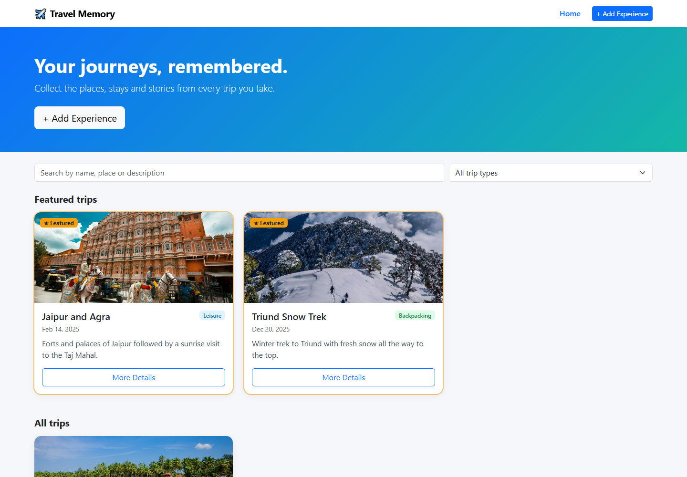

I added 3 trips. The MongoDB ids came out as `6af3422981af28c1...` for two of them and `6af342295c62fc3c...` for the third. The middle part of a MongoDB ObjectId is different for each running process, so this shows the requests were handled by both backend servers.

## Step 8 - Failover test

To check that the load balancer really handles a server going down:

1. Stopped the app on backend-1: `sudo pm2 stop tm-backend`
2. After about a minute the ALB marked backend-1 as **unhealthy** and sent all traffic to backend-2.
3. Sent 10 requests to `https://travel.rajeshdevops.in/trip` and all 10 returned 200. The site kept working.
4. Started the app again with `sudo pm2 start tm-backend` and the target became **healthy** again.

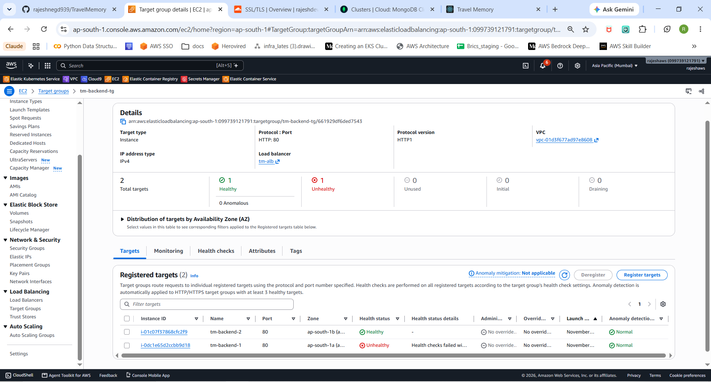
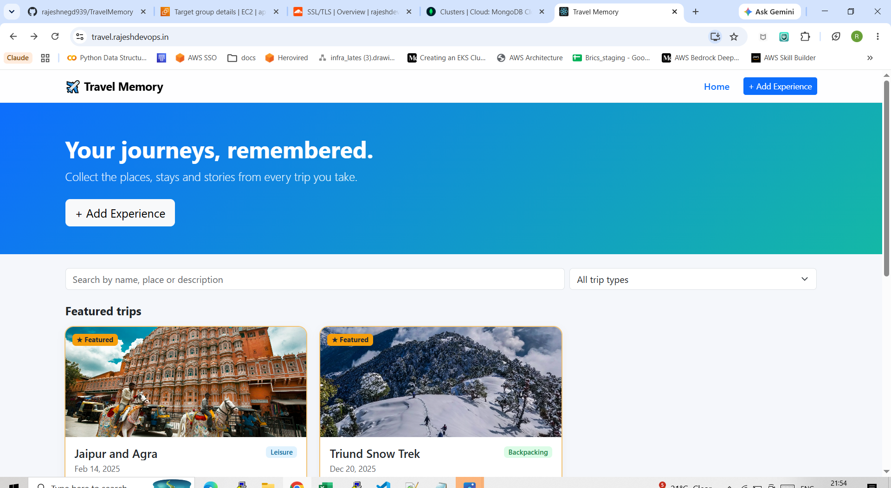

---

## Problems I faced

1. **`.in` domain on Cloudflare** - Cloudflare Registrar gave an error that `.in` is not supported. Bought the domain on GoDaddy and pointed its nameservers to Cloudflare instead. The new domain also took some time to show up in DNS.
2. **Backend kept crashing** - After the first deploy the backend target group was unhealthy. `pm2 status` showed the app restarted more than 190 times and `pm2 logs` said Atlas was blocking the connection. The backend server IPs were not in the Atlas access list. After adding both IPs the app connected on its next automatic restart, no change was needed on the servers.
3. **AWS CLI error "The filter 'null' is invalid"** - The first `describe-vpcs` call failed. In PowerShell an unquoted value like `Name=isDefault,Values=true` is treated as an array because of the comma. Putting the filter values in quotes fixed it.
4. **Port 3000 vs 3001** - The repo code defaults to 3001 but the assignment says 3000, so I set the port in `.env` and pointed nginx to 3000.

## Security

- Backend and frontend servers accept HTTP only from the load balancer security group
- SSH is open only for my own IP
- Atlas allows only the 2 backend server IPs
- DB password is only in `.env` on the servers, not in Git
- HTTPS for users through Cloudflare
- The app already has helmet headers, CORS limited to my domains, and rate limiting

## Known limitations / what can be improved

- **Uploaded images** are saved on the disk of the backend server that received the upload. With 2 backends an image may not be found when the other server answers. Moving uploads to S3 (or EFS) would fix this. For the sample trips I used image links.
- **SSL is Flexible**, so traffic between Cloudflare and AWS is plain HTTP. Better option is an ACM certificate on an HTTPS listener and Cloudflare mode **Full (strict)**.
- `alb-sg` allows the whole internet. It could allow only Cloudflare IP ranges.
- Backend public IPs change if the instances are stopped and started, and then Atlas must be updated. Elastic IPs or a NAT gateway would avoid that.
- Instances were created one by one, not by an Auto Scaling Group. A launch template + ASG would replace a failed server automatically.

## Cost and cleanup

The load balancer and the public IPv4 addresses are charged per hour, so after testing I deleted everything: load balancer, target groups, Elastic IP, the 4 instances, the 3 security groups and the key pair.

---

## About the app (original README)

Running the app locally, the API list and data format are in the original repo: https://github.com/UnpredictablePrashant/TravelMemory#readme

| Method | Path | Description |
|---|---|---|
| GET | `/trip` | List trips |
| GET | `/trip/:id` | Get one trip |
| POST | `/trip` | Create a trip (JSON or multipart with image) |
| GET | `/uploads/:file` | Uploaded images |
| GET | `/health` | 200 when API and DB are up |
